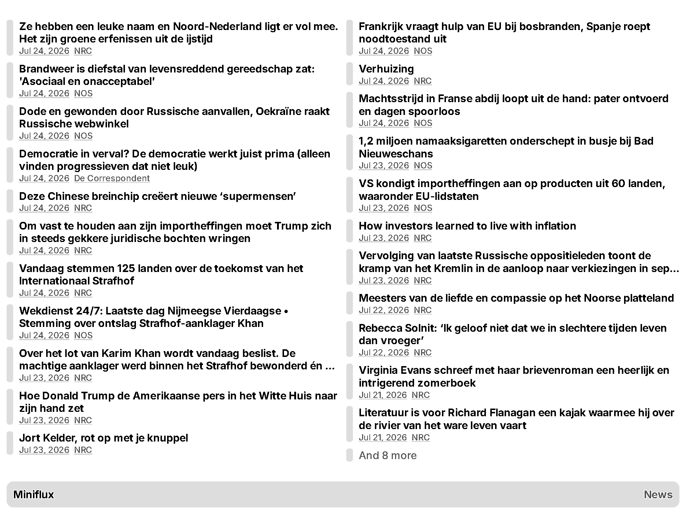

# TRMNL Miniflux Plugin

A [TRMNL](https://trmnl.com/) plugin which displays your latest [Miniflux](https://miniflux.app/) entries. Originally inspired by the original [plugin](https://trmnl.com/recipes/33478).



## Development

You can run this plugin locally for development by copying `.env.example` into `.env` and filling the required environment variables. Then, run:

```
./bin/trmnlp serve
```

## Contributing

Feel free to open an issue or a pull request.

## License

[CC-BY 4.0](LICENSE) © [Henrique Dias](https://hacdias.com)
